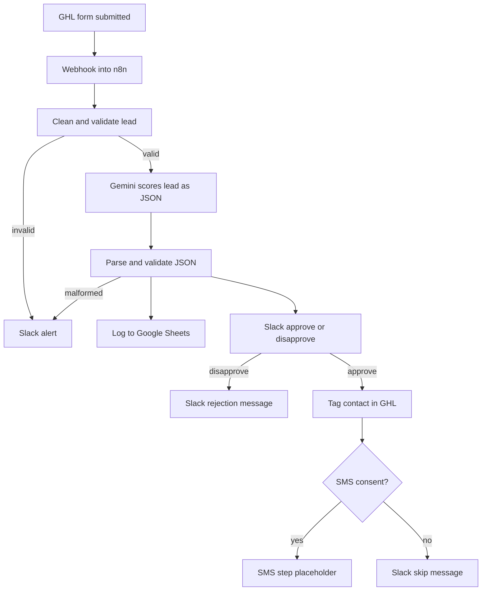

# AI Lead Qualification Workflow (GoHighLevel + n8n)

A lead-to-booking automation: a lead fills in a GoHighLevel form, n8n cleans and validates the data, an LLM scores the lead and drafts a reply, a human approves in Slack, and only then does the contact get tagged in the CRM. Every failure path ends in an alert instead of silently passing bad data along.

> **Status:** working end to end on test data. No client results are claimed. See [Known limitations](#known-limitations).

## How it works



## Stack

- **GoHighLevel:** forms, contacts, tags (accessed through its API with a Private Integration token)
- **n8n:** all workflow logic
- **Gemini API:** lead scoring (`gemini-2.5-flash`), returns strict JSON
- **Slack:** failure alerts and the human approval step
- **Google Sheets / Looker Studio:** AI call log and dashboard

## Design decisions

- **The model only scores and drafts.** Nothing reaches a lead or the CRM until a person approves.
- **Model output is untrusted.** The reply is parsed and checked (valid JSON, known category, score in range, required fields). Anything else raises an alert.
- **Errors are handled by type.** Temporary failures (429, 503) are retried with a wait. Permanent ones (401, 403, 400/422) are not retried, because they would fail identically, and instead alert a human.
- **SMS is gated on consent.** The form carries an unticked consent checkbox, and the workflow only reaches the SMS step for consenting leads.
- **Every AI call is logged** with token counts so usage is visible.

## Error handling

| Status | Meaning | Response |
|---|---|---|
| 401 | Bad or expired credentials | No retry, alert, rotate credential |
| 403 | Missing permission (scope) | No retry, alert, add scope |
| 400 / 422 | Request body rejected | No retry, log body and error, fix mapping |
| 429 | Rate limit | Batch and retry with a wait |
| 503 | Temporary overload | Retry with a wait, alert if retries run out |

## Repository contents

```
/workflows        n8n workflow export (JSON, sanitised)
/docs
  SOP.pdf         standard operating procedure
  dashboard.png   screenshot of the Looker Studio report
README.md
```

## Setup

1. Import the workflow JSON into n8n (Workflows, Import from file).
2. Create these credentials in n8n. **Never put keys inside node fields.**
   - GHL: Header Auth, name `Authorization`, value `Bearer <Private Integration token>`. Every GHL request also needs a `Version: 2021-07-28` header. Scopes used: contact read/write and custom-fields read.
   - Gemini: Header Auth, name `x-goog-api-key`, value your key from Google AI Studio.
   - Slack and Google Sheets credentials.
3. Create the `AI Lead Log` sheet with columns: `timestamp, contact_id, category, score, input_tokens, output_tokens, model, status`.
4. In GHL, build a workflow with a Form Submitted trigger and a Custom Webhook action pointing at your n8n production URL, sending the contact fields and the SMS consent value.
5. Set the default country code at the top of the cleaning node, then activate the workflow.

## Testing

| Test | Expected |
|---|---|
| Valid lead, approve | Tag applied, log row written |
| Valid lead, disapprove | No tag, rejection message in Slack |
| Invalid email | Slack alert, no AI call |
| Broken AI output | Slack alert, no approval message |
| Consent ticked / unticked | Reaches SMS step / Slack skip message |

Use pinned webhook data for repeatable tests and unpin before real submissions.

## Known limitations

- Writing consent time and source back to GHL custom fields is built but not yet confirmed working.
- No real SMS is sent, and no A2P 10DLC campaign has been registered. The SMS step is a placeholder.
- The Gemini free tier has daily and per-minute limits.
- All results shown come from test data.

## Security

The exported workflow contains no secrets, but exports can still include webhook URLs, sheet IDs and GHL location IDs. Check the JSON before publishing. If a token was ever exposed, rotate it.

## Author

Oluwaseyi, building AI automation systems with n8n and GoHighLevel.
